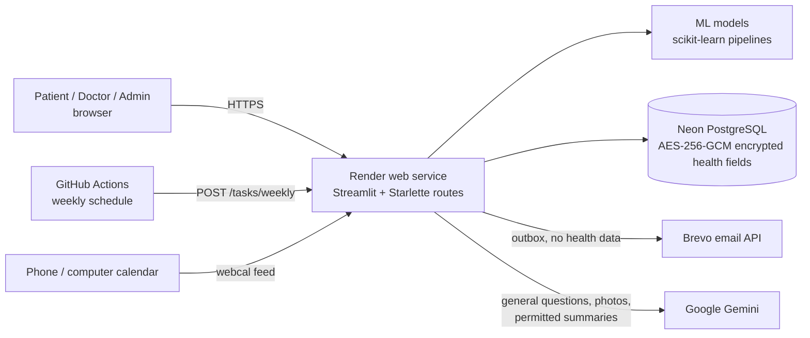

# ✚ AHEAD — Analytical Health Early Awareness and Detection

**Senior Design Project · American University of Ras Al Khaimah (AURAK)**

AHEAD is a web platform for early awareness of **diabetes**, **cardiovascular disease** and **chronic kidney
disease**. Patients answer short health and lifestyle questions and get an explained machine-learning screening
estimate; linked doctors review results, prescribe medication and prevention plans, and follow their patients'
progress. It is built for privacy from the start: encrypted health data, recorded consent, retention rules and no
health information in emails.

**Live demo:** [ahead-hepa.onrender.com](https://ahead-hepa.onrender.com) (free hosting: the first visit after a
quiet spell takes about a minute to wake up)

> **Educational screening only.** AHEAD does not diagnose disease and must not be used to start, stop or change
> treatment. The live site holds **test accounts only**; no real patient data.

---

## Contents

1. [Features](#features)
2. [How it works](#how-it-works)
3. [Machine learning results](#machine-learning-results)
4. [Security and privacy](#security-and-privacy)
5. [Testing](#testing)
6. [Getting started](#getting-started)
7. [Configuration](#configuration)
8. [Project structure](#project-structure)
9. [Limitations and future work](#limitations-and-future-work)
10. [Team](#team)

---

## Features

### For patients
- **Screenings** for three conditions with a gauge, a clear result track (*See a doctor soon*, *At risk*, *Not
  flagged*), the factors AHEAD noticed, next steps and a downloadable **PDF report**. Lab values (HbA1c, glucose,
  creatinine, eGFR, urine ACR) are optional and checked by clinical rules.
- **Care team:** link one or more doctors and remove them at any time.
- **My plan:** medication and prevention plans from linked doctors, with dose check-offs and progress.
- **Medicine reminders** in the patient's own phone or computer calendar (private `webcal://` link).
- **Health & Lifestyle Tracker** (check-ins, trends, goals, 30×30 activity challenge) and a **Food Nutrition
  Analyzer** (photo estimate, always confirmed by the patient).
- **AI Assistant:** questions about the patient's own doses and score, and how-to questions about AHEAD, are
  answered inside the app; general health questions go to Google Gemini, with streamed answers and read-aloud.

### For doctors
- **Linked patients:** saved assessments, score history, dose adherence and activity.
- **Medication and prevention plans:** create, edit, pause and stop. The patient is notified of every change.
- **Clinical Dashboard:** upload de-identified CSV/Excel cohorts, validate rows, score them, record review
  decisions and export CSV/PDF.
- **Notifications** for new results and newly linked patients (every result, or only those needing attention).

### For administrators
- **Accounts & Security:** create doctor accounts with one-time set-up links, switch accounts off or on, send
  reset links, audit log, email delivery log, consent status and data-protection status.
- Administrators manage accounts only and **never see health data**.

---

## How it works



| Layer | Technology |
|---|---|
| Interface | Streamlit (multi-page, role-based navigation, light and dark themes) |
| Server | Starlette routes alongside Streamlit (`server.py`): sessions, calendar feed, health check, scheduled tasks, security headers |
| Machine learning | scikit-learn and XGBoost pipelines, Plotly charts, ReportLab PDFs |
| Data | PostgreSQL on Neon (SQLite for local development), versioned SQL migrations |
| Email | Brevo HTTPS API through an outbox with retries and daily limits |
| AI | Google Gemini (`google-genai`), optional and consent-based |
| Hosting | Render (Frankfurt), GitHub Actions for the weekly job |

---

## Machine learning results

All models are trained on **real CDC survey data** (NHANES 1999–2023 and BRFSS 2022); nothing is synthetic. For
diabetes and kidney, the newest NHANES cycle (2021–2023) is held out as the test set, so the models are tested on
people surveyed after the training data. Thresholds are tuned on a separate validation set.

| Condition | Model | Test rows | ROC-AUC (95% CI) | Sensitivity | Specificity | Simple baseline AUC |
|---|---|---|---|---|---|---|
| Diabetes (HbA1c ≥ 5.7 %) | Logistic regression | 4,966 | **0.735** (0.719–0.748) | 86.0 % | 48.3 % | 0.722 (partial ADA risk test) |
| Kidney marker (eGFR < 60 or ACR ≥ 30) | Logistic regression | 5,551 | **0.776** (0.759–0.792) | 66.2 % | 77.4 % | 0.750 (risk-factor count) |
| Cardiovascular (past heart attack) | Logistic regression | 49,205 | **0.828** (0.821–0.834) | 79.7 % | 71.0 % | 0.729 (risk-factor count) |

Every model beats its baseline (paired bootstrap, 1,000 resamples, p < 0.001). Full results with confusion
matrices, calibration and fairness by sex and age come from `scripts/evaluate_models.py` and are saved in
[`docs/evaluation/results.json`](docs/evaluation/results.json). Data sources and label definitions are in
[`docs/data_sources.md`](docs/data_sources.md).

**Honest limits:** one threshold serves every age, so diabetes flags almost everyone aged 60+, and kidney and
heart rarely flag people under 40. The app shows a note on those results. The heart model learns what people who
*had* a heart attack look like; it is not a 10-year forecast.

---

## Security and privacy

| Area | What AHEAD does |
|---|---|
| Accounts | Salted PBKDF2 passwords, email confirmation, one-time links bound to their purpose, rate limits, no account enumeration |
| Sessions | Sign-in belongs to one browser tab (HttpOnly cookie + tab secret), 2 h idle / 12 h maximum, sign out everywhere |
| Access control | Patients see only their own data; doctors only linked patients; admins no health data |
| Encryption | Health values encrypted per field with AES-256-GCM (`AHEAD_FIELD_KEY`, rotatable); start-up stops if the database holds encrypted values the key can't open (set the key before the first deploy) |
| Consent | Versioned consent text recorded per patient; withdrawing it is respected everywhere, including AI features |
| Retention | Notifications 90 days, email records 30 days, audit log 1 year, switched-off accounts erased after 1 year |
| Email | Never contains health values, medicine names or patient names; bodies deleted once sent |
| Browser | Strict Content-Security-Policy (no inline scripts, no eval, no framing) |
| AI | Patient-specific answers stay inside AHEAD; Gemini gets only what each feature needs, with consent |

Independent code reviews were run before submission (security, data protection and a final full review). Findings, fixes and accepted risks are in
[`docs/risk_register.md`](docs/risk_register.md).

---

## Testing

- **534 automated tests** in 33 files (pytest), run on SQLite and on PostgreSQL, with and without the
  encryption key; each encrypted run also checks that no health value was stored unencrypted.
- Layout checks (`scripts/check_redesign.py`) and browser checks of every page for every role at desktop and phone
  size, with zero Content-Security-Policy violations.
- Upgrade checks: a database from the previous version is started on the new one.

```bash
python -m pytest -q                                   # SQLite
AHEAD_TEST_DATABASE_URL=postgresql://... python -m pytest -q   # local PostgreSQL only
```

---

## Getting started

```bash
git clone <this repository>
cd ahead
python -m venv .venv
.venv\Scripts\activate            # macOS/Linux: source .venv/bin/activate
pip install -r requirements.txt
streamlit run server.py
```

Open `http://localhost:8501` and create a patient account on the sign-in page. Without `DATABASE_URL` the app
uses a local SQLite file. Create the first admin with
`python scripts/create_account.py --email you@example.com --name "Your Name" --role Admin`, then add doctors from
**Accounts & Security**. For a classroom run, `run_windows.bat` also creates local demo accounts.

The trained models are included. To rebuild the datasets and models from CDC's public files, see
[Re-training the models](docs/technical_guide.md#re-training-the-models).

---

## Configuration

Settings are environment variables (Render → Environment in production). Secrets never go in the repository.

| Variable | Purpose |
|---|---|
| `DATABASE_URL` | PostgreSQL connection (omit for local SQLite) |
| `AHEAD_FIELD_KEY` | Encryption key for health values (keep a copy in a password manager) |
| `AHEAD_PUBLIC_URL` | The site's address, used in emailed links |
| `BREVO_API_KEY`, `AHEAD_EMAIL_FROM` | Turn emails on and set the sender |
| `GEMINI_API_KEY` | Turn the AI features on |
| `AHEAD_TASK_KEY` | Secret for the weekly scheduled task |

The full list, deployment steps on Render + Neon, email rules, the calendar feed and troubleshooting are in the
**[technical guide](docs/technical_guide.md)**.

---

## Project structure

```
ahead/
├── server.py              ← production entry point (Streamlit + HTTP routes + background jobs)
├── app.py                 ← routing and navigation
├── train_model.py         ← trains and benchmarks six model families per condition
├── ahead/                 ← application package
│   ├── pages/             ← one module per page (screenings, plans, dashboards, admin, assistant, ...)
│   ├── migrations/        ← versioned SQL migrations, run at start-up
│   ├── screening.py       ← screening flow       ├── triage.py      ← result tracks and lab rules
│   ├── accounts.py        ← sessions and links   ├── fieldcrypt.py  ← field encryption
│   ├── consent.py         ← consent              ├── retention.py   ← retention and erasure
│   ├── platform_data.py   ← care team and plans  ├── mailer.py      ← email outbox
│   └── reports.py         ← PDF reports          └── calendar_feed.py ← medicine reminder feed
├── models/                ← trained pipelines and metadata
├── data/                  ← CDC training data
├── scripts/               ← data building, evaluation, account and key tools
├── tests/                 ← automated tests
└── docs/                  ← technical guide, evaluation, data sources, risk register
```

---

## Limitations and future work

**Limitations:** trained on US survey data, not UAE patients; one threshold for all ages; the heart label is a past
event; free hosting is slow and sleeps when idle; English only.

**Future work:** retraining and validation with UAE clinical data and per-age-group thresholds; UAE hosting and
ethics approval before any real patients (UAE Federal Law No. 2 of 2019); a self-hosted language model in the UAE
instead of Gemini; Arabic; Sign in with Microsoft; a usability study with patients and clinicians.

---

## Team

Senior Design Project, American University of Ras Al Khaimah (AURAK), 2026.

- Syed Mudassir Shahab
- Hamad Alshehhi
- Emna Daly
- Ahad Alnuaimi
- Obaid Almazrouei
- Omar Alnuaimi

**Supervisor:** Dr Khaled Abdelgader Balawafi

**Data:** CDC National Health and Nutrition Examination Survey (public domain); CDC Behavioral Risk Factor
Surveillance System 2022, prepared by Kamil Pytlak on Kaggle (CC0).
